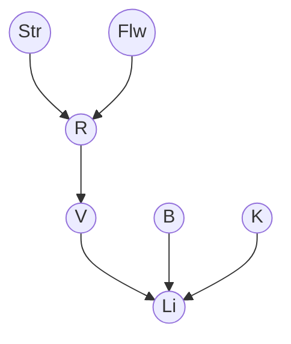

# Trabalho-Metodologias-Ativas-Raciocínio-Probabilistico
# Rede Bayesiana – Diagnóstico do Farol de Bicicleta a Dínamo
 
**Disciplina:** Inteligência Artificial – 2º Trabalho (Metodologias Ativas: Raciocínio Probabilístico)
**Professor:** Edjard Mota · **Turma:** E500 & CB01 · UFAM – ICOMP
**Aluno:** Luis Manoel Lima Abdalla
 
Resolução da 1ª questão, itens (a) a (e).
 
## Variáveis
 
| Variável | Significado | Valores |
|---|---|---|
| `Li` | Luz ligada | t / f |
| `Str` | Condição da rua | dry, wet, snow_covered |
| `Flw` | Volante do dínamo desgastado | t / f |
| `R` | Dínamo deslizante | t / f |
| `V` | Dínamo mostra tensão | t / f |
| `B` | Lâmpada ok | t / f |
| `K` | Cabo ok | t / f |
 
## (a) Estrutura da rede
 
Arestas: **Str → R, Flw → R, R → V, V → Li, B → Li, K → Li**
 

 
Justificativa:
 
- `Str`, `Flw`, `B` e `K` são raízes (independentes aos pares).
- `V` tem apenas `R` como pai, pois P(V|R,Str) = P(V|R) e P(V|R,Flw) = P(V|R).
- `Li` tem `V`, `B` e `K` como pais, pois P(Li|V,R) = P(Li|V).
- `B` e `K` só se ligam a `V` e `R` por meio de `Li`, que não é observado. Logo (R,B), (R,K), (V,B) e (V,K) são independentes.
## (b) CPTs faltantes
 
Cada nó precisa de uma tabela de probabilidades condicionais (CPT), com uma linha para cada combinação dos valores dos pais.
 
| Nó | Pais | Tabela | Linhas |
|---|---|---|---|
| Str | nenhum | P(Str) | 1 (3 valores) |
| Flw | nenhum | P(Flw = t) | 1 |
| B | nenhum | P(B = t) | 1 |
| K | nenhum | P(K = t) | 1 |
| R | Str, Flw | P(R = t \| Str, Flw) | 3 × 2 = 6 |
| V | R | P(V = t \| R) | 2 |
| Li | V, B, K | P(Li = t \| V, B, K) | 2 × 2 × 2 = 8 (dada no enunciado) |
 
Em cada tabela, P(nó = f \| pais) = 1 − P(nó = t \| pais).
 
## (c) Valores plausíveis
 
**P(Str)**
 
| dry | wet | snow_covered |
|---|---|---|
| 0,7 | 0,2 | 0,1 |
 
**Raízes binárias**
 
| P(Flw = t) | P(B = t) | P(K = t) |
|---|---|---|
| 0,1 | 0,95 | 0,98 |
 
**P(R = t | Str, Flw)**
 
| Str | Flw = f | Flw = t |
|---|---|---|
| dry | 0,05 | 0,40 |
| wet | 0,20 | 0,70 |
| snow_covered | 0,40 | 0,90 |
 
**P(V = t | R)**
 
| R | P(V = t) |
|---|---|
| t | 0,1 |
| f | 0,9 |
 
**P(Li = t | V, B, K)** (tabela do enunciado)
 
| V | B | K | P(Li = t) |
|---|---|---|---|
| t | t | t | 0,99 |
| t | t | f | 0,01 |
| t | f | t | 0,01 |
| t | f | f | 0,001 |
| f | t | t | 0,3 |
| f | t | f | 0,005 |
| f | f | t | 0,005 |
| f | f | f | 0 |
 
## (d) A rede não contém a aresta (Str, Li)
 
A rede fatora a distribuição conjunta como:
 
```
P(Str,Flw,R,V,B,K,Li) = P(Str)·P(Flw)·P(R|Str,Flw)·P(V|R)·P(B)·P(K)·P(Li|V,B,K)
```
 
Então:
 
```
P(Li | V,B,K,Str) = [ P(Str)·P(B)·P(K)·P(Li|V,B,K) · Σ_{Flw,R} P(Flw)·P(R|Str,Flw)·P(V|R) ]
                    / [ o mesmo termo somado sobre Li ]
```
 
O fator com a soma não depende de `Li` e cancela no quociente, restando **P(Li | V,B,K)**.
 
Logo **Li ⊥ Str | V,B,K**: dados os seus pais, `Li` não depende de `Str`, e não existe aresta direta. `Str` influencia `Li` apenas pelo caminho Str → R → V → Li, que é bloqueado por `V` (cadeia).
 
## (e) Cálculo de P(V | Str = snow_covered)
 
Marginalizando `Flw`:
 
```
P(R=t | snow) = P(R=t|snow,Flw=f)·P(Flw=f) + P(R=t|snow,Flw=t)·P(Flw=t)
              = 0,4·0,9 + 0,9·0,1
              = 0,36 + 0,09
              = 0,45
```
 
Marginalizando `R`:
 
```
P(V=t | snow) = P(V=t|R=t)·0,45 + P(V=t|R=f)·0,55
              = 0,1·0,45 + 0,9·0,55
              = 0,045 + 0,495
              = 0,54
 
P(V=f | snow) = 1 − 0,54 = 0,46
```
 
**Resposta:** P(V = t | Str = snow_covered) = **0,54** e P(V = f | Str = snow_covered) = **0,46**.
 
